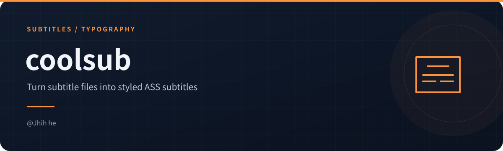
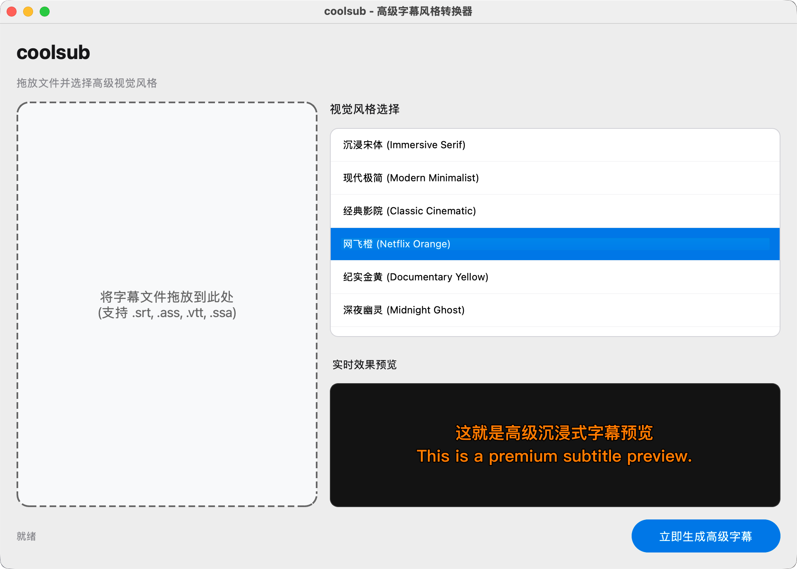

<!-- readme-visuals:header:start -->
<p align="center"></p>

<p align="center">
  <a href="https://github.com/jhihhe/coolsub/commits/main"></a>
  <a href="https://github.com/jhihhe/coolsub/stargazers"></a>
  <a href="https://github.com/jhihhe"></a>
</p>
<!-- readme-visuals:header:end -->

<div align="center">
  <h1>coolsub</h1>
  <p><strong>高级字幕视觉风格转换器 | Premium Subtitle Style Transformer</strong></p>

  <p>
    <a href="https://github.com/jhihhe/coolsub/blob/main/LICENSE">
      
    </a>
    
    
    
  </p>

  <p>
    <b>简体中文</b> | <a href="README_EN.md">English</a>
  </p>

  
</div>

---

**coolsub** 是一款专为追求极致观影体验的用户设计的字幕美化工具。它能将普通的字幕文件（SRT, VTT, ASS等）一键转换为具有电影质感、高级排版的 ASS 字幕。

<!-- readme-visuals:overview:start -->

## 项目速览

<table>
<tr>
<td width="33%"><strong>字幕转换</strong><br><br>将 SRT、VTT、ASS 等输入转换为 ASS 字幕。</td>
<td width="33%"><strong>风格与预览</strong><br><br>内置风格选择，转换前查看效果。</td>
<td width="33%"><strong>批量拖放</strong><br><br>支持多文件拖放，在源文件夹生成结果。</td>
</tr>
</table>

### 流程概览


<!-- readme-visuals:overview:end -->

## ✨ 特性

- **沉浸式视觉**: 内置多种精心设计的高级风格，包括经典的“沉浸宋体”、现代极简、以及标志性的“网飞橙”。
- **编码自适应**: 智能识别并修复 UTF-8、UTF-16🔍搜 UTF-16 及带 BOM 的多种编码格式，告别乱码。
- **实时预览**: 在转换前即可实时查看不同风格的渲染效果。
- **极简交互**: 支持多文件批量拖放处理，直接在源文件夹生成。
- **macOS 原生感**: 基于 PySide6 构建的现代图形界面，深度适配 macOS。

## 🎨 内置风格展示

- 📜 **沉浸宋体 (Immersive Serif)**: 极致克制，如阅读纸质书般的电影质感。
- 📱 **现代极简 (Modern Minimalist)**: 清爽利落，适合现代剧集。
- 🎬 **经典影院 (Classic Cinematic)**: 怀旧复古，浓郁的胶片氛围。
- 🍊 **网飞橙 (Netflix Orange)**: Netflix 标志性橙色，高辨识度。
- 🎥 **纪实金黄 (Documentary Yellow)**: 专业且醒目的纪录片风格。

## 🚀 快速开始

### 安装依赖
```bash
pip install PySide6 pysubs2
```

### 运行程序
```bash
python3 src/main.py
```

### 打包为 .app
```bash
python3 build.py
```

## 📄 源码与版权信息

- **开发者**: [jhihhe](https://github.com/jhihhe)
- **开源协议**: MIT License
- **核心依赖**: PySide6, pysubs2

Copyright (c) 2026 **jhihhe**. All rights reserved.
